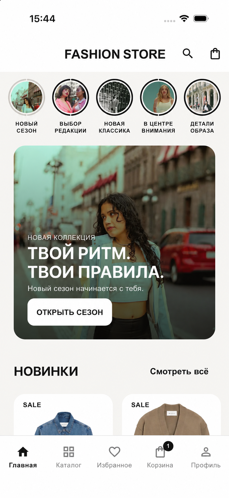
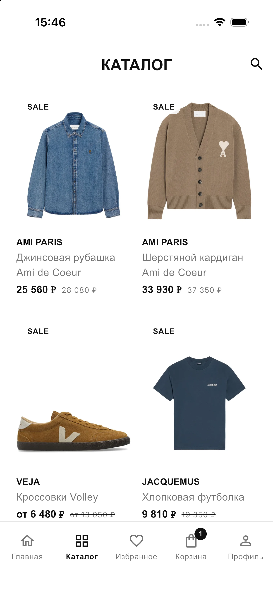
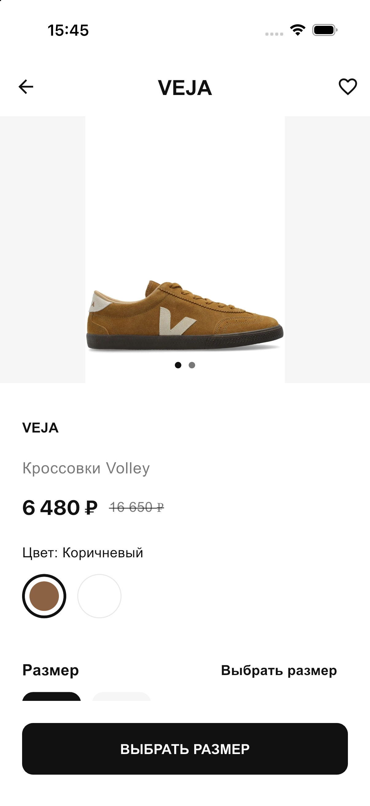
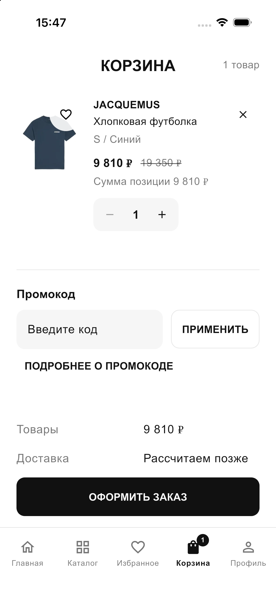

<a href="README.md">English</a> · <a href="README.ru.md">Русский</a>

<h1 align="center">Fashion Commerce</h1>

A mobile shopping experience spanning editorial discovery, product browsing and a streamlined basket.

   

A public showcase of a private project, presenting anonymized interfaces and key workflows. Source code and internal project materials remain private.

## Key workflows

- Editorial discovery and product browsing
- Product variants and item details
- Basket and purchase preparation

## Gallery

Screens are presented individually with their proportions preserved. Identifying branding, contacts and data are replaced with demo content. These previews illustrate the product and do not imply a live service is available.

Some images were anonymized with AI.

### Editorial discovery

### Catalog

### Product details

### Basket

---

[Explore all projects](https://github.com/svllvsx)
